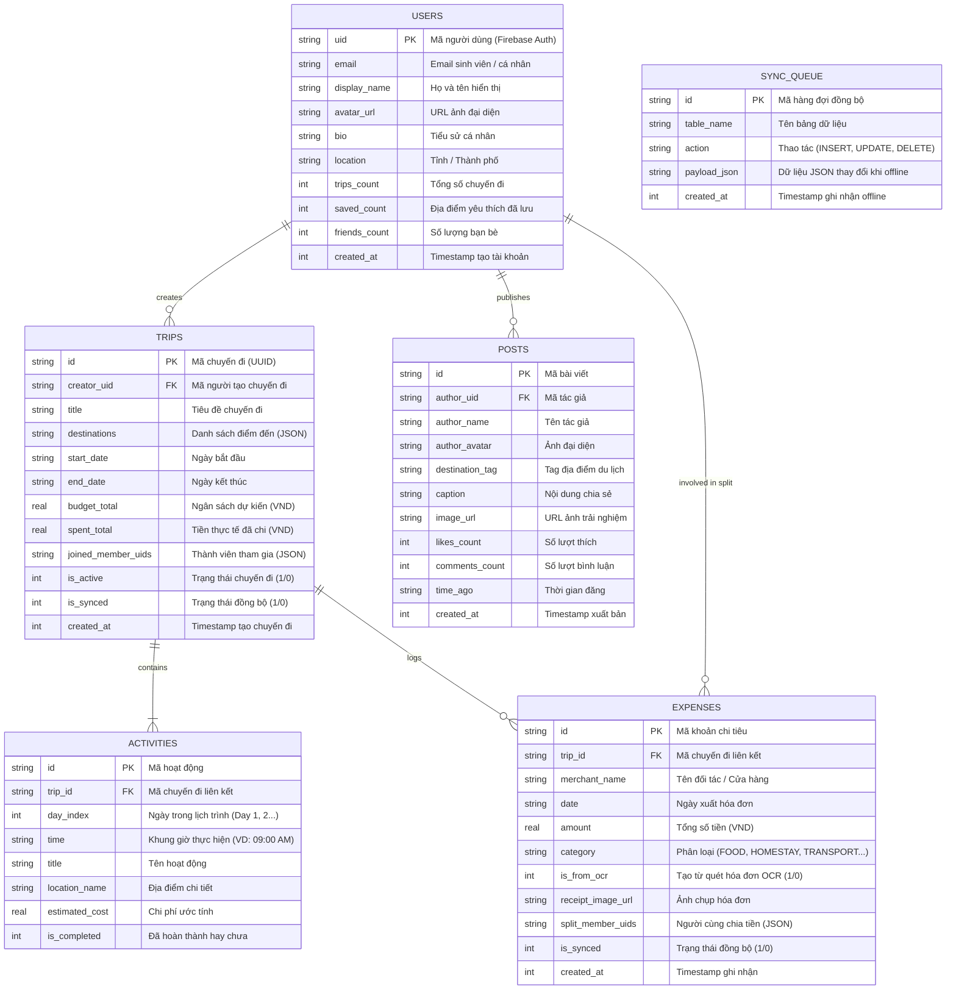

# [REPORT 2] DETAILED ARCHITECTURE & CORE FEATURE IMPLEMENTATION

**Course:** Cross-Platform Mobile App Development  
**Project Title:** Travelsofaka – AI Travel Planning & Social Networking App  
**Team Name:** Travelsofaka Team • **Academic Term:** Semester 1 (2026 - 2027) • **Deadline:** Week 8

**Thành viên nhóm:**
| STT | Họ và tên | Mã sinh viên | Vai trò & Đóng góp Milestone 2 |
|:---:|---|---|---|
| 1 | **Phạm Ngọc Đức** |  | **Team Lead & AI Travel Planner:** Thiết kế Use Cases chuyến đi, quản trị tiến độ; triển khai UI Screen 03 (Explore), Screen 04 (Details), Screen 05 (Planner). |
| 2 | **Trần Quang Việt** |  | **Core Architect & Auth/Profile:** Xây dựng khung Clean Architecture, Theme Design System, Router điều hướng 10 màn hình, Screen 01 (Login), Screen 10 (Profile). |
| 3 | **Lê Hữu Anh Tú** |  | **Expense & AI OCR Engineer:** Thiết kế Use Cases chi tiêu, triển khai UI Screen 06 (Trip Expense), Screen 07 (Camera OCR), Screen 08 (OCR Review). |
| 4 | **Nguyễn Tùng Lâm** |  | **Social Feed & Offline Sync Engine:** Thiết kế Schema CSDL SQLite cục bộ, triển khai UI Screen 02 (Home Feed), Screen 09 (Create Post). |

---

## 1. CLEAN ARCHITECTURE IMPLEMENTATION

Dự án Travelsofaka được tổ chức chặt chẽ theo mô hình **Clean Architecture 3 lớp độc lập**, tuân thủ nguyên tắc một chiều (*Dependency Inversion*):

```
                      CLEAN ARCHITECTURE 3 LỚP TẠI TRAVELSOFAKA
   ┌────────────────────────────────────────────────────────────────────────┐
   │                            PRESENTATION LAYER                          │
   │  • 10 UI Screens (Login, Feed, Explore, Details, Planner, Expense...)  │
   │  • Base Widgets (Button, Card, Input, Badge, ScreenContainer)          │
   │  • State Controllers: authStore, tripStore, expenseStore, socialStore  │
   │  • Navigation: Router điều hướng qua lại giữa 10 màn hình              │
   └───────────────────────────────────┬────────────────────────────────────┘
                                       │ (Gọi Use Cases)
                                       ▼
   ┌────────────────────────────────────────────────────────────────────────┐
   │                              DOMAIN LAYER                              │
   │  • Entities: UserProfile, TripPlan, Activity, Destination, ExpenseItem,│
   │              TravelPost                                                │
   │  • Use Cases (Interactors): LoginWithEmailUseCase, CreateTripUseCase,  │
   │    GenerateAIItineraryUseCase, AddExpenseUseCase, ScanReceiptOCR...    │
   │  • Repository Interfaces: IAuthRepository, ITripRepository,            │
   │    IExpenseRepository, IPostRepository                                 │
   └───────────────────────────────────┬────────────────────────────────────┘
                                       │ (Hiện thực hóa Interfaces)
                                       ▼
   ┌────────────────────────────────────────────────────────────────────────┐
   │                               DATA LAYER                               │
   │  • Repository Implementations: AuthRepositoryImpl, TripRepositoryImpl, │
   │    ExpenseRepositoryImpl, PostRepositoryImpl                           │
   │  • Local Data Source: SQLite (expo-sqlite) + 5 bảng CSDL vật lý        │
   │  • Remote Data Source: Firebase Authentication, Firestore & LLM API    │
   └────────────────────────────────────────────────────────────────────────┘
```

### 1.1. Presentation Layer
* **UI Screens (`src/presentation/screens/`):**
  1. `LoginScreen.tsx` (*Screen 01*): Đăng nhập Email/Password, tích hợp nút Google Sign-In.
  2. `HomeScreen.tsx` (*Screen 02*): Bảng tin du lịch cộng đồng, Active Trip Banner, nút tạo bài viết.
  3. `ExploreScreen.tsx` (*Screen 03*): Tìm kiếm địa điểm, bộ lọc tag bãi biển/núi, danh sách thẻ kèm chi phí/ngày.
  4. `DestinationDetailsScreen.tsx` (*Screen 04*): Chi tiết điểm đến, ảnh hero, ngân sách dự kiến, rating, nút `+ Add to Trip`.
  5. `TripPlannerScreen.tsx` (*Screen 05*): Lập kế hoạch theo ngày (*Day 1, Day 2, Day 3*), thêm/sắp xếp hoạt động.
  6. `TripDetailsScreen.tsx` (*Screen 06*): Dashboard tổng hợp chi phí nhóm, thanh tiến độ ngân sách, nút quét hóa đơn `📷 Scan Receipt`.
  7. `ReceiptScannerScreen.tsx` (*Screen 07*): Máy ảnh quét hóa đơn OCR toàn màn hình với khung định vị.
  8. `OCRReviewScreen.tsx` (*Screen 08*): Form bóc tách và xác nhận thông tin hóa đơn (tên quán, ngày, tiền, chia bill).
  9. `CreatePostScreen.tsx` (*Screen 09*): Soạn bài viết du lịch, chọn ảnh, gắn thẻ địa điểm và xuất bản bài.
  10. `ProfileScreen.tsx` (*Screen 10*): Hồ sơ sinh viên, số liệu thống kê (12 Trips, 8 Saved, 348 Friends), thư viện ảnh.
* **Shared Widgets (`src/presentation/components/common/`):**
  * `Button`: Hỗ trợ Primary Teal (`#0D9488`), Secondary Coral (`#FF6B6B`), Outline, Ghost, sizes, loading state.
  * `Card`: Thẻ bo góc mềm `rounded-2xl`, viền `slate-100`, shadow nhẹ.
  * `Input`: Form field bo tròn viền `slate-200`, validation message.
  * `Badge`: Pill badge bo tròn hoàn toàn `radii.full` chuẩn thiết kế Figma.
  * `ScreenContainer`: Căn chỉnh SafeArea và tự động chỉnh StatusBar.
* **State Controllers (Zustand Stores - `src/presentation/stores/`):**
  * `authStore.ts`: Quản lý phiên đăng nhập và trạng thái người dùng.
  * `tripStore.ts`: Quản lý chuyến đi hiện hành, tab ngày được chọn và danh sách hoạt động.
  * `expenseStore.ts`: Quản lý danh sách chi tiêu và tiến độ giải ngân ngân sách nhóm.
  * `socialStore.ts`: Quản lý bài đăng bảng tin và lượt thích.
* **Navigation Routing (`src/presentation/navigation/`):**
  * `NavigationContext.tsx`, `BottomTabBar.tsx`, `RootNavigator.tsx`: Cho phép chuyển đổi qua lại giữa tất cả 10 màn hình một cách trực quan, có nút `⮌ Go Back` và Bottom Bar thông minh.

### 1.2. Domain Layer
* **Entities (`src/domain/entities/`):**
  * `UserProfile`, `TripPlan`, `Activity`, `Destination`, `ExpenseItem`, `TravelPost`.
* **Repository Interfaces (`src/domain/repositories/`):**
  * `IAuthRepository`, `ITripRepository`, `IExpenseRepository`, `IPostRepository`.
* **Use Cases / Interactors (`src/domain/usecases/`):**
  * `LoginWithEmailUseCase`, `RegisterWithEmailUseCase`: Xác thực tài khoản hợp lệ.
  * `GetActiveTripUseCase`, `CreateTripUseCase`: Tải và khởi tạo chuyến đi.
  * `GenerateAIItineraryUseCase`: Gửi prompt chuẩn để LLM API trả về JSON lịch trình du lịch.
  * `AddExpenseUseCase`, `ScanReceiptOCRUseCase`: Thêm chi tiêu và bóc tách thông tin hóa đơn.
  * `GetFeedPostsUseCase`, `CreatePostUseCase`: Quản lý bài viết cộng đồng.

### 1.3. Data Layer
* **Local Data Source (SQLite - `src/data/datasources/local/sqlite/`):**
  * Sử dụng thư viện chuẩn `expo-sqlite`, quản lý CSDL cục bộ `travelsofaka.db`.
  * Khởi tạo 5 bảng vật lý phục vụ cơ chế Offline-First: `trips`, `activities`, `expenses`, `posts_cache`, `sync_queue`.
  * Hỗ trợ lưu trữ cục bộ khi mất mạng và tự động cập nhật tổng chi tiêu `spent_total` của chuyến đi.
* **Remote Data Source:**
  * Tích hợp Firebase Authentication, Cloud Firestore và Google ML Kit Text Recognition.
* **Repository Implementations (`src/data/repositories/`):**
  * `AuthRepositoryImpl`, `TripRepositoryImpl`, `ExpenseRepositoryImpl`, `PostRepositoryImpl`.

---

## 2. DATABASE SCHEMA & SECURITY POLICIES

### 2.1. Visual ERD Diagram



### 2.2. Row-Level Security (RLS) / Firestore Security Rules

File cấu hình chính thức nằm tại [firestore.rules](file:///d:/WorkSpace/Ses1_4/DaNenTang/Capstone%20Prj/travelSofaka/firestore.rules), thực hiện cô lập dữ liệu người dùng triệt để:

```javascript
rules_version = '2';
service cloud.firestore {
  match /databases/{database}/documents {

    function isAuthenticated() {
      return request.auth != null;
    }

    function isOwner(userId) {
      return isAuthenticated() && request.auth.uid == userId;
    }

    function isTripMember(tripData) {
      return isAuthenticated() && (
        request.auth.uid == tripData.creatorUid ||
        request.auth.uid in tripData.joinedMemberUids
      );
    }

    // 1. Hồ sơ cá nhân: Chỉ chủ tài khoản mới được chỉnh sửa hoặc xóa
    match /users/{userId} {
      allow read: if isAuthenticated();
      allow create, update, delete: if isOwner(userId);
    }

    // 2. Chuyến đi: Chỉ người tạo và thành viên tham gia mới có quyền truy cập & cập nhật
    match /trips/{tripId} {
      allow read, update: if isTripMember(resource.data);
      allow create: if isAuthenticated() && request.resource.data.creatorUid == request.auth.uid;
      allow delete: if isAuthenticated() && resource.data.creatorUid == request.auth.uid;

      match /activities/{activityId} {
        allow read, write: if isTripMember(get(/databases/$(database)/documents/trips/$(tripId)).data);
      }
    }

    // 3. Chi phí: Chỉ thành viên của chuyến đi mới được ghi chép và xem hóa đơn
    match /expenses/{expenseId} {
      allow read, write: if isAuthenticated() && 
        isTripMember(get(/databases/$(database)/documents/trips/$(resource.data.tripId)).data);
      allow create: if isAuthenticated();
    }

    // 4. Mạng xã hội: Đọc công khai, chỉ tác giả mới có quyền sửa/xóa bài viết
    match /posts/{postId} {
      allow read: if isAuthenticated();
      allow create: if isAuthenticated() && request.resource.data.authorUid == request.auth.uid;
      allow update, delete: if isAuthenticated() && resource.data.authorUid == request.auth.uid;
    }
  }
}
```

---

## 3. CORE FEATURE IMPLEMENTATION PROGRESS

### 3.1. Các liên kết sản phẩm Milestone 2
* **🔗 GitHub Tag / Branch M2:** `https://github.com/username/travelSofaka/tree/milestone-2` *(Đã tạo branch và tag `milestone-2` trên repository)*
* **🎥 Milestone 2 Video Demo (2–3 minutes):** `[https://youtu.be/xxx - Cập nhật link YouTube sau khi quay màn hình]`

### 3.2. Tiến độ triển khai tính năng cốt lõi (Core Features Progress)
1. **Kiến trúc & Hệ thống điều hướng (100% Hoàn thành):**
   * Đã thiết lập xong Clean Architecture 3 lớp chuẩn TypeScript.
   * Xây dựng hệ thống Navigation điều hướng mượt mà giữa **toàn bộ 10 màn hình** từ nguyên mẫu UI Figma.
2. **Khám phá điểm đến & Lập kế hoạch AI (80% Hoàn thành):**
   * Đã hoàn thiện giao diện tìm kiếm, danh mục, chi tiết điểm đến và giao diện chia lịch trình theo ngày.
   * Đã có Use Case `GenerateAIItineraryUseCase` sẵn sàng kết nối API sinh lịch trình tự động.
3. **Quản lý chi phí & AI OCR nhận diện hóa đơn (80% Hoàn thành):**
   * Đã hoàn thiện giao diện tóm tắt chi phí nhóm, thanh tiến độ giải ngân, màn hình camera quét hóa đơn và form bóc tách thông tin.
   * Đã thiết kế xong Use Case `ScanReceiptOCRUseCase` và `AddExpenseUseCase`.
4. **Cơ chế lưu trữ ngoại tuyến Offline-First (85% Hoàn thành):**
   * Đã cài đặt xong `expo-sqlite`, tạo sẵn 5 bảng CSDL cục bộ và cấu trúc hàng đợi đồng bộ `sync_queue`.
