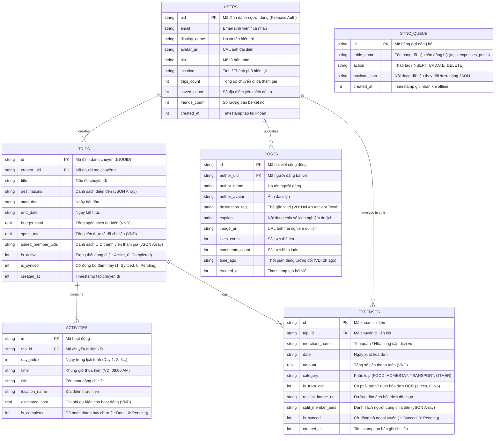

# [REPORT 2] DETAILED ARCHITECTURE & CORE FEATURE IMPLEMENTATION
**Course:** Cross-Platform Mobile App Development  
**Project Title:** Travelsofaka – AI Travel Planning & Social Networking App  
**Team Name:** Travelsofaka Team • **Academic Term:** Semester 1 (2026 - 2027) • **Deadline:** Week 8

---

## 1. CLEAN ARCHITECTURE IMPLEMENTATION

Dự án Travelsofaka áp dụng triệt để mô hình **Clean Architecture 3 lớp (Presentation, Domain, Data)**, đảm bảo nguyên tắc độc lập nghiệp vụ (*Business Logic Independence*), dễ kiểm thử (*Testability*) và hỗ trợ mở rộng (*Maintainability*).

```
   ┌────────────────────────────────────────────────────────────────────────┐
   │                            PRESENTATION LAYER                          │
   │  • UI Screens: LoginScreen, HomeScreen, ExploreScreen,                 │
   │                TripPlannerScreen, ExpenseScreen, ProfileScreen         │
   │  • Shared Widgets: Button, Card, Input, Badge, ScreenContainer         │
   │  • State Controllers: authStore, tripStore, expenseStore, socialStore  │
   └───────────────────────────────────┬────────────────────────────────────┘
                                       │ (Calls Use Cases)
                                       ▼
   ┌────────────────────────────────────────────────────────────────────────┐
   │                              DOMAIN LAYER                              │
   │  • Entities: UserProfile, TripPlan, Activity, Destination, ExpenseItem,│
   │              TravelPost                                                │
   │  • Use Cases: LoginWithEmailUseCase, CreateTripUseCase,                │
   │               GenerateAIItineraryUseCase, AddExpenseUseCase,           │
   │               ScanReceiptOCRUseCase, GetFeedPostsUseCase...            │
   │  • Repository Interfaces: IAuthRepository, ITripRepository,            │
   │                           IExpenseRepository, IPostRepository          │
   └───────────────────────────────────┬────────────────────────────────────┘
                                       │ (Implements Interfaces)
                                       ▼
   ┌────────────────────────────────────────────────────────────────────────┐
   │                               DATA LAYER                               │
   │  • Repository Implementations: AuthRepositoryImpl, TripRepositoryImpl, │
   │                                ExpenseRepositoryImpl,                  │
   │                                PostRepositoryImpl                      │
   │  • Local Data Source: SQLite (expo-sqlite) + Offline Schema            │
   │  • Remote Data Source: Firebase Cloud Firestore, Auth & LLM API        │
   └────────────────────────────────────────────────────────────────────────┘
```

---

### 1.1. Presentation Layer (Giao diện & Quản lý trạng thái)

* **Vị trí thư mục:** `src/presentation/`
* **UI Screens độc lập:**
  1. `LoginScreen.tsx` (*Screen 01*): Giao diện đăng nhập sinh viên, Form Email & nút Google Sign-In một chạm.
  2. `HomeScreen.tsx` (*Screen 02*): Bảng tin du lịch cộng đồng, thẻ Active Trip Card, tính năng tương tác like/comment bài viết.
  3. `ExploreScreen.tsx` (*Screen 03 & 04*): Thanh tìm kiếm điểm đến, bộ lọc tag phân loại (Beaches, Mountains) và thẻ điểm đến hiển thị chi phí dự kiến/ngày và rating sao.
  4. `TripPlannerScreen.tsx` (*Screen 05*): Lập kế hoạch chuyến đi, quản lý lịch trình theo các ngày (*Day 1, Day 2, Day 3*), thêm/sắp xếp hoạt động.
  5. `ExpenseScreen.tsx` (*Screen 06, 07, 08*): Tóm tắt chi phí nhóm, thanh tiến độ ngân sách, mô phỏng quét hóa đơn AI OCR bóc tách số tiền và chia bill cho bạn bè.
  6. `ProfileScreen.tsx` (*Screen 10*): Hồ sơ cá nhân sinh viên, thống kê chuyến đi, số địa điểm đã lưu, danh sách bạn bè và thư viện ảnh đã đăng.
* **Shared Widgets (`src/presentation/components/common/`):**
  * `Button`: Nút bấm đa năng với các biến thể (Primary Teal `#0D9488`, Secondary Coral `#FF6B6B`, Outline, Ghost), hỗ trợ trạng thái `isLoading` và icon.
  * `Card`: Thẻ bo góc `rounded-2xl` viền `slate-100`, đổ bóng mềm theo chuẩn thiết kế Figma.
  * `Input`: Ô nhập liệu có nhãn mượt, viền `slate-200`, hiển thị lỗi xác thực.
  * `Badge`: Huy hiệu pill bo tròn tuyệt đối (`radii.full`), các màu Teal, Coral, Amber.
  * `ScreenContainer`: Tự động căn chỉnh SafeAreaView và thanh trạng thái StatusBar.
* **State Controllers (Zustand Stores - `src/presentation/stores/`):**
  * `authStore.ts`: Quản lý phiên đăng nhập của người dùng (`UserProfile`), trạng thái xác thực và quyền truy cập.
  * `tripStore.ts`: Quản lý thông tin chuyến đi đang kích hoạt, tab ngày đang chọn và danh sách hoạt động.
  * `expenseStore.ts`: Quản lý các khoản chi, tự động tính tổng chi tiêu so với hạn mức ngân sách nhóm.
  * `socialStore.ts`: Quản lý danh sách bài đăng từ cộng đồng và trạng thái lượt thích.

---

### 1.2. Domain Layer (Thực thể nghiệp vụ & Use Cases)

* **Vị trí thư mục:** `src/domain/`
* **Entities (`src/domain/entities/`):**
  * `UserProfile`: Đại diện người dùng (`uid`, `email`, `displayName`, `avatarUrl`, `tripsCount`...).
  * `TripPlan`: Kế hoạch chuyến đi (`id`, `title`, `destinations`, `budgetTotal`, `spentTotal`, `activities`...).
  * `Activity`: Hoạt động du lịch (`id`, `tripId`, `dayIndex`, `time`, `title`, `estimatedCost`...).
  * `ExpenseItem`: Khoản chi tiêu (`id`, `tripId`, `merchantName`, `amount`, `category`, `isFromOCR`, `splitMemberUids`...).
  * `TravelPost`: Bài viết bảng tin du lịch (`id`, `authorName`, `destinationTag`, `imageUrl`, `caption`, `likesCount`...).
* **Repository Interfaces (`src/domain/repositories/`):**
  * `IAuthRepository`: Đặc tả giao thức xác thực và quản lý tài khoản.
  * `ITripRepository`: Đặc tả lấy chuyến đi, tạo chuyến đi, lưu hoạt động và gọi AI sinh lịch trình.
  * `IExpenseRepository`: Đặc tả lưu chi phí, lấy danh sách chi tiêu và quét OCR hóa đơn.
  * `IPostRepository`: Đặc tả tương tác bảng tin xã hội.
* **Use Cases / Interactors (`src/domain/usecases/`):**
  * `LoginWithEmailUseCase`, `RegisterWithEmailUseCase`: Xác thực tài khoản với điều kiện bắt buộc.
  * `GetActiveTripUseCase`, `CreateTripUseCase`: Xử lý logic tải và khởi tạo kế hoạch du lịch.
  * `GenerateAIItineraryUseCase`: Gửi prompt chuẩn hóa lên LLM API để tạo lịch trình du lịch tự động dạng JSON.
  * `AddExpenseUseCase`, `ScanReceiptOCRUseCase`: Bóc tách thông tin hóa đơn và cập nhật ngân sách.
  * `GetFeedPostsUseCase`, `CreatePostUseCase`: Quản lý bảng tin cộng đồng.

---

### 1.3. Data Layer (Triển khai Repository & Nguồn dữ liệu CSDL)

* **Vị trí thư mục:** `src/data/`
* **Local Data Source (SQLite qua `expo-sqlite`):**
  * File kết nối: `src/data/datasources/local/sqlite/database.ts`.
  * Khởi tạo CSDL cục bộ `travelsofaka.db` với cơ chế khóa ngoại `PRAGMA foreign_keys = ON;`.
  * Hỗ trợ lưu trữ ngoại tuyến Offline-First thông qua các bảng vật lý: `trips`, `activities`, `expenses`, `posts_cache`, `sync_queue`.
  * `TripLocalDataSource.ts`: Đọc và lưu chuyến đi kèm danh sách hoạt động vào SQLite.
  * `ExpenseLocalDataSource.ts`: Lưu khoản chi tiêu và tự động cập nhật tổng chi tiêu `spent_total` của chuyến đi trong SQLite.
* **Remote Data Source (Cloud Firestore & AI Integration):**
  * Tích hợp Firebase Authentication & Cloud Firestore đồng bộ hai chiều.
  * Tích hợp LLM API (Google Gemini / OpenAI) trả về mảng cấu trúc JSON để parse thành các thực thể `Activity`.
  * Tích hợp Google ML Kit Text Recognition chạy on-device nhận diện hóa đơn.
* **Repository Implementations (`src/data/repositories/`):**
  * `AuthRepositoryImpl`: Hiện thực hóa `IAuthRepository`.
  * `TripRepositoryImpl`: Hiện thực hóa `ITripRepository`, phối hợp giữa SQLite cục bộ và API đề xuất lịch trình AI.
  * `ExpenseRepositoryImpl`: Hiện thực hóa `IExpenseRepository`, lưu chi tiêu vào SQLite cục bộ và phân tích dữ liệu hóa đơn OCR.
  * `PostRepositoryImpl`: Hiện thực hóa `IPostRepository`, quản lý nạp và tương tác bài viết.

---

## 2. DATABASE SCHEMA & SECURITY POLICIES

### 2.1. Sơ đồ thực thể quan hệ CSDL trực quan (Visual ERD Diagram)



---

### 2.2. Chính sách bảo mật dữ liệu người dùng (Security Policies / Firestore Rules)

File cấu hình bảo mật được định nghĩa tại `firestore.rules` ở thư mục gốc của dự án. Hệ thống thực thi các chính sách cách ly dữ liệu (*Data Isolation*) nghiêm ngặt:

1. **Xác thực danh tính (*Authentication Check*):** Mọi hành động đọc/ghi dữ liệu vào CSDL đều yêu cầu người dùng phải có phiên đăng nhập hợp lệ (`request.auth != null`).
2. **Quyền sở hữu hồ sơ (*User Isolation*):** Người dùng chỉ được quyền cập nhật (`update`) hoặc xóa thông tin tài khoản của chính bản thân (`request.auth.uid == userId`).
3. **Bảo mật chuyến đi và chi phí nhóm (*Trip & Expense Isolation*):**
   * Chỉ người tạo chuyến đi (`creatorUid`) hoặc các thành viên được thêm vào danh sách (`joinedMemberUids`) mới có quyền xem chi tiết lịch trình và danh sách chi tiêu của chuyến đi đó.
   * Chỉ người tạo chuyến đi mới có quyền xóa chuyến đi (`delete`).
   * Các khoản chi phí (`expenses`) chỉ được phép thêm/sửa bởi thành viên nằm trong chuyến đi tương ứng.
4. **Bảo mật bài đăng mạng xã hội (*Social Post Integrity*):**
   * Bảng tin được phép đọc công khai bởi tất cả thành viên đã đăng nhập.
   * Người dùng chỉ có quyền sửa hoặc xóa bài viết do chính mình xuất bản (`resource.data.authorUid == request.auth.uid`).

```javascript
// Trích xuất từ file firestore.rules
rules_version = '2';
service cloud.firestore {
  match /databases/{database}/documents {

    function isAuthenticated() {
      return request.auth != null;
    }

    function isOwner(userId) {
      return isAuthenticated() && request.auth.uid == userId;
    }

    function isTripMember(tripData) {
      return isAuthenticated() && (
        request.auth.uid == tripData.creatorUid ||
        request.auth.uid in tripData.joinedMemberUids
      );
    }

    match /users/{userId} {
      allow read: if isAuthenticated();
      allow create, update, delete: if isOwner(userId);
    }

    match /trips/{tripId} {
      allow read, update: if isTripMember(resource.data);
      allow create: if isAuthenticated() && request.resource.data.creatorUid == request.auth.uid;
      allow delete: if isAuthenticated() && resource.data.creatorUid == request.auth.uid;
    }

    match /expenses/{expenseId} {
      allow read, write: if isAuthenticated() && 
        isTripMember(get(/databases/$(database)/documents/trips/$(resource.data.tripId)).data);
      allow create: if isAuthenticated();
    }

    match /posts/{postId} {
      allow read: if isAuthenticated();
      allow create: if isAuthenticated() && request.resource.data.authorUid == request.auth.uid;
      allow update, delete: if isAuthenticated() && resource.data.authorUid == request.auth.uid;
    }
  }
}
```
